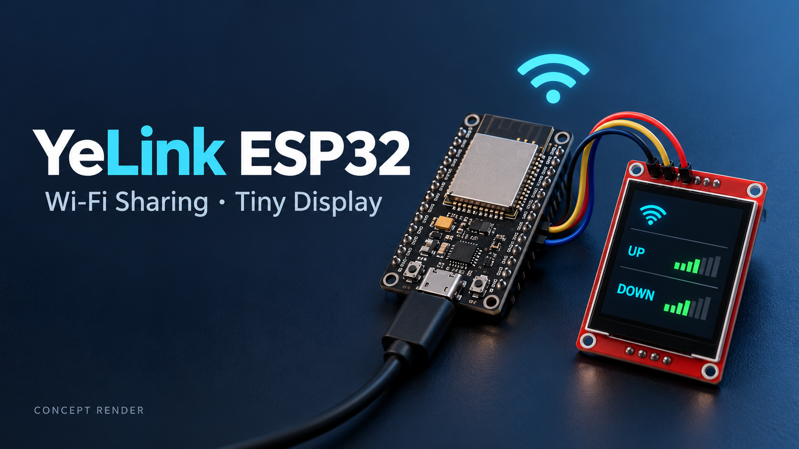
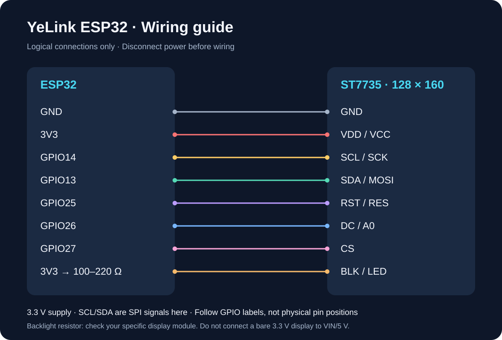

# YeLink ESP32

**让一块 ESP32，成为带小屏的 Wi-Fi 共享节点。**



> AI 生成的概念效果图，用于展示项目形态；不是实拍、实际接线或固件界面截图。接线以教程为准。

[快速上手](docs/tutorial.md) · [使用说明](小屏伙伴使用说明.md) · [验证记录](docs/validation.md) · [MIT 许可证](LICENSE)

YeLink ESP32 基于原生 ESP-IDF，把经典 ESP32 开发板与 128×160 ST7735 SPI 彩屏组合起来，提供手机配网、IPv4 Wi-Fi 共享、实时状态显示，以及可选的云端文字、照片和动画控制。

## 能做什么

| 功能 | 说明 |
| --- | --- |
| Wi-Fi 共享 | AP + STA，通过 IPv4 NAPT 共享上游 2.4 GHz Wi-Fi，最多 2 台热点客户端 |
| 手机配网 | 连接热点后访问 `http://192.168.4.1`，无需预先写入上游密码 |
| 小屏状态 | 路由模式取得上游 IP 后显示上传/下载速率、CPU、内存和最近网络日志 |
| 离线动画 | 未配网或丢失上游 IP 时显示本地动画与连接提示 |
| 云端控制 | 支持 HTTPS + Bearer 令牌协议的文字、照片、自定义动画控制；需自行提供兼容服务端 |
| 转发诊断 | NAPT 容量、强制淘汰、UDP 超时、IPv4 分片与 TCP MSS 统计 |

路由模式和云端模式分开运行。云端模式不启用热点网络转发；路由模式不启动云端轮询。服务端不包含在此仓库中。

## 准备硬件

- 经典双核 ESP32 开发板，目标为 `esp32`，不是 ESP32-S3。
- ST7735R/S、128×160、SPI 接口彩屏。
- USB 数据线、杜邦线、背光串联电阻（100Ω～220Ω，按模块规格调整）。



图中展示逻辑连接，不代表开发板的实际针脚排列。屏幕上标为 SCL/SDA 的信号在此为 SPI 时钟/数据；供电用 3.3V。

## 快速开始

安装并激活 **ESP-IDF v6.1** 环境后：

```sh
git clone https://github.com/Ye9137/YeLink-ESP32.git
cd YeLink-ESP32
python3 scripts/prepare_demo_animation.py
idf.py set-target esp32
idf.py -B build/default build
idf.py -B build/default -p YOUR_SERIAL_PORT flash monitor
```

`YOUR_SERIAL_PORT` 替换为实际串口，例如 Linux 的 `/dev/ttyUSB0`、macOS 的 `/dev/cu.usbserial-xxxx` 或 Windows 的 `COM3`。在 Windows ESP-IDF 终端中可用 `python` 替代 `python3`。若工具没有加入 PATH，用 `python "$IDF_PATH/tools/idf.py"`（POSIX shell）调用。

首次启动连接 **Ye的共享wifi**，默认 WPA2 密码为 **11111111**，打开 `http://192.168.4.1`，选择“单纯 Wi-Fi 路由器”、填写上游 Wi-Fi 并开启网络共享。保存重启后重新连接热点。

详细步骤、接线表、修改热点密码、动画替换和排障见 [图文教程](docs/tutorial.md)。

## 动画与开源范围

公开仓库提供原创几何信号动画生成脚本，只需 Python 标准库。原开发环境的第三方猫咪 GIF、转换资源和个人照片不随仓库发布；生成的资源也不纳入版本管理。你可以通过 `scripts/prepare_cat_gif.py` 转换自己有权使用的 GIF。

源码保留已有的互动绘图及动画播放接口。第三方角色形象的权利不因本项目 MIT 许可证转移，参见 [第三方声明](THIRD_PARTY_NOTICES.txt)。

## 构建与验证

源码内固件标识为版本 17。当前验证范围和构建结果见 [验证记录](docs/validation.md)。

```sh
python3 scripts/test_router_tcp_mss.py
python3 scripts/test_router_ip4.py
```

上述测试需主机 C 编译器及 AddressSanitizer/UndefinedBehaviorSanitizer。它们验证报文处理逻辑，不替代真实硬件、无线吞吐、VPN 或屏幕效果测试。

经典 ESP32 使用单个 2.4 GHz 无线电转发，性能取决于信号、信道、客户端与上游网络。不承诺固定网速。当前仅共享 IPv4，不提供原生 IPv6 路由、端口映射或 OTA；上游子网不能与 `192.168.4.0/24` 重叠。

## 目录

```text
main/          固件、屏幕驱动、配网页和网络转发逻辑
scripts/       素材转换、示例动画生成和主机测试
docs/          图文教程、验证记录和效果图
sdkconfig.defaults  可复现的默认配置
partitions.csv      Flash 分区表
dependencies.lock   ESP-IDF 组件依赖锁
```

欢迎通过 Issues 报告问题。请附上开发板与屏幕型号、ESP-IDF 版本、复现步骤和已去除密码/令牌的日志。

## 许可证

项目代码采用 [MIT](LICENSE)，Copyright (c) 2026 Ye。第三方组件及参考代码保留原许可证，见 [THIRD_PARTY_NOTICES.txt](THIRD_PARTY_NOTICES.txt)。
